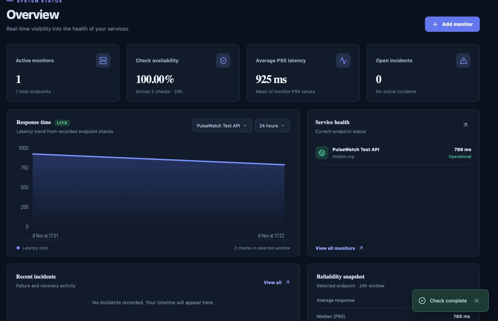
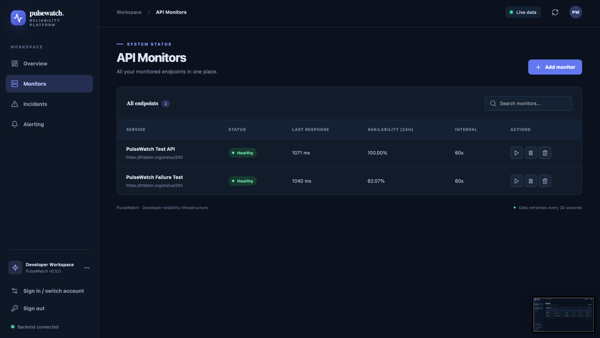
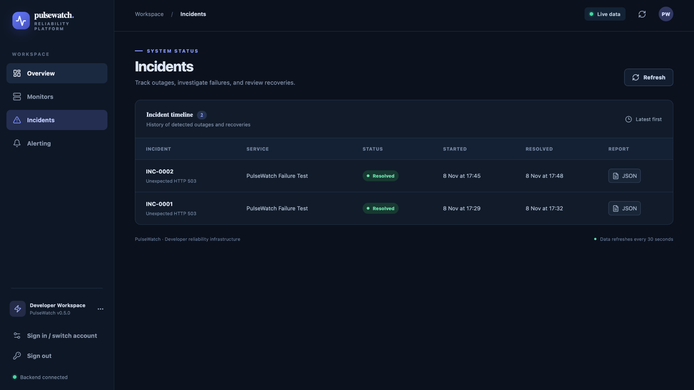
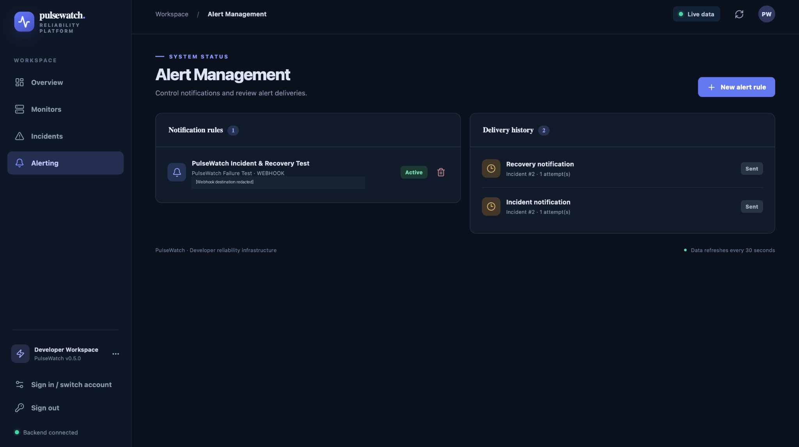

# PulseWatch

**API Performance & Reliability Monitor**

**Developed by Arabome Obadiah Ayodeji**

PulseWatch is a full-stack API monitoring application designed to measure HTTP endpoint performance, track service availability, detect outages and record incident recovery.

It combines a Python/FastAPI backend, PostgreSQL database, scheduled monitoring worker and React dashboard to provide a centralised view of API reliability.

The project explores practical backend and reliability engineering challenges, including job scheduling, persistent operational records, failure detection, incident lifecycle management and external notification delivery.

**Current status:** Portfolio MVP — locally deployed and functionally validated. Not yet a publicly hosted production service.

## Technology Stack

| Layer | Technology |
|---|---|
| Backend | Python, FastAPI, SQLAlchemy |
| Database | PostgreSQL 16 |
| Database migrations | Alembic |
| Frontend | React, TypeScript, Vite |
| Infrastructure | Docker, Docker Compose |
| HTTP client | HTTPX |
| Testing | pytest, GitHub Actions |
| Notification delivery | HTTPS Webhooks, SMTP support |

## Features

- **Scheduled API monitoring:** Configure and automatically monitor HTTP(S) endpoints at defined intervals.
- **Latency tracking:** Record response times and calculate P50, P95 and P99 measurements.
- **Availability analytics:** Calculate observed availability from successful and failed HTTP checks.
- **Incident detection:** Generate incidents when consecutive failures exceed a configured threshold.
- **Automatic recovery tracking:** Resolve incidents when an affected endpoint responds successfully.
- **Webhook notifications:** Deliver incident-opening and recovery notifications to external services.
- **Incident reporting:** Maintain incident history with timestamps, failure reasons and JSON report exports.
- **Authentication and access control:** Administrator and viewer accounts with role-based permissions.
- **Containerised deployment:** Separate backend, worker, PostgreSQL and frontend services.

## Application Screenshots

The screenshots below were captured from a functioning local PulseWatch deployment using real HTTP test responses.

### 1. Performance Overview



Live API response-time visualisation, observed check availability, latency metrics and service-health reporting.

### 2. API Monitors



Configured endpoints with health status, response time, monitoring intervals and historical availability.

### 3. Incident Detection and Recovery



Recorded incidents showing HTTP 503 service failures and subsequent recovery.

### 4. Alert Management



Webhook alert configuration and notification delivery history for incident and recovery events.

## Architecture

PulseWatch separates its API management layer from the background worker responsible for health checks and alert delivery.

```text
React Dashboard
      |
      v
FastAPI Backend
      |
      v
PostgreSQL Database
      ^
      |
Monitoring Worker
      |
      +---- HTTP Endpoint Checks
      |
      +---- Failure Detection
      |
      +---- Incident Lifecycle
      |
      +---- Notification Delivery
                  |
                  +---- HTTPS Webhooks
                  +---- SMTP (configurable)
```

The system stores operational measurements and incident state in PostgreSQL. The worker performs scheduled checks independently of the frontend.

Worker leasing supports recovery of unfinished scheduled work. Database constraints help prevent duplicate alert-event records, while external notifications follow at-least-once delivery semantics.

See [Architecture](docs/ARCHITECTURE.md) for technical details.

## Local Deployment

### Prerequisites

- Docker Desktop
- Docker Compose
- Git

Clone the repository:

```bash
git clone https://github.com/DejiMorgan/pulsewatch.git
cd pulsewatch
```

Create your environment configuration:

```bash
cp .env.example .env
```

Configure the required environment variables privately, including database credentials and development settings. Ensure the PostgreSQL password agrees with the password embedded in `DATABASE_URL`.

Start the application:

```bash
docker compose up --build -d
```

Verify container status:

```bash
docker compose ps
```

The application runs four services: FastAPI, PostgreSQL, monitoring worker and React dashboard.

### Local addresses

| Service | Address |
|---|---|
| Dashboard | http://localhost:3000 |
| API documentation | http://localhost:8000/docs |
| Health endpoint | http://localhost:8000/health |
| Database readiness | http://localhost:8000/ready |

These addresses are accessible only when the local containers are running.

### Administrator setup

Create your administrator account using the repository's bootstrap module:

```bash
docker compose exec api python -m app.bootstrap_admin
```

Supply the required `ADMIN_EMAIL` and `ADMIN_PASSWORD` environment variables securely to the container before execution. PulseWatch requires an administrator password of at least 12 characters.

Never commit passwords, API keys or `.env` files.

See [Deployment Instructions](PHASE5_DEPLOYMENT.md) for additional configuration guidance.

## Testing and Validation

PulseWatch was validated through automated tests, Docker execution and controlled HTTP failure-and-recovery experiments.

### Automated Testing

The backend test suite recorded 16 passing tests during local validation, using SQLite and mocks for selected behaviours.

The GitHub Actions workflow initially identified a frontend TypeScript compilation error. After correction, the subsequent workflow completed successfully across the backend, PostgreSQL and frontend jobs.

The React frontend also completed a local production build using:

```bash
cd frontend
npm install
npm run build
```

### Functional Validation — 8 November 2026

| Test | Observed result |
|---|---|
| Docker services start | Passed |
| API and database health checks | Passed |
| Scheduled HTTP checks | Passed |
| Latency data recording | Passed |
| Repeated HTTP failure detection | Passed |
| Automatic incident creation | Passed |
| Recovery detection | Passed |
| Incident resolution | Passed |
| Webhook incident notification | Received |
| Webhook recovery notification | Received |

### Controlled Incident Experiment

A dedicated test monitor was configured to receive HTTP 503 responses.

After the consecutive-failure threshold was reached, PulseWatch created an incident and recorded its failure reason.

The test endpoint was subsequently restored to HTTP 200, allowing the monitoring system to detect recovery and resolve the incident.

Two incidents were successfully recorded and resolved during validation.

| Incident | Opened | Resolved |
|---|---|---|
| INC-0001 | 17:29 | 17:32 |
| INC-0002 | 17:45 | 17:48 |

Times above are the local times displayed in the dashboard on 8 November 2026.

For INC-0002, the application also delivered two HTTPS webhook requests to an external test receiver:

- Incident opened — `event_type: opened`
- Incident resolved — `event_type: resolved`

Both requests were observed in the receiver's request history and associated with the same incident.

**Testing limitation:** These results establish functional correctness under controlled local conditions. They do not establish long-term service uptime, high availability, production scalability or performance under sustained load.

## Engineering Decisions

The project prioritises separation of responsibilities, reproducible deployment and traceable operational data.

Key decisions include:

- Keeping API management separate from scheduled background execution.
- Persisting check results and incident state in PostgreSQL.
- Using configurable consecutive-failure thresholds to avoid opening incidents for every isolated failure.
- Recording recovery as part of the incident lifecycle.
- Maintaining notification delivery records to support troubleshooting.
- Using Docker Compose to reproduce the application environment locally.

See [Engineering Decisions](docs/DECISIONS.md) and [Case Study](docs/CASE_STUDY.md).

## Repository Structure

```text
pulsewatch/
├── backend/
│   ├── app/
│   ├── alembic/
│   ├── integration/
│   └── tests/
├── frontend/
│   └── src/
├── docs/
│   ├── screenshots/
│   ├── ARCHITECTURE.md
│   ├── CASE_STUDY.md
│   └── DECISIONS.md
├── scripts/
├── .github/
│   └── workflows/
├── docker-compose.yml
├── docker-compose.prod.yml
├── README.md
├── SECURITY.md
└── LICENSE
```

## Current Limitations and Future Work

PulseWatch is a portfolio implementation rather than a production-grade monitoring service.

Areas for further development include:

- Public demo deployment with hardened configuration.
- Longer-duration reliability testing.
- Multi-worker concurrency and failover validation.
- Load testing and performance benchmarking.
- Verification of SMTP email notification delivery.
- Additional observability and diagnostic tooling.
- Expanded automated integration and end-to-end test coverage.
- Improved monitoring-state presentation during consecutive failures.

## Project Links

**Source code:** [GitHub — DejiMorgan/pulsewatch](https://github.com/DejiMorgan/pulsewatch)

**Author:** Arabome Obadiah Ayodeji

**License:** MIT — see [LICENSE](LICENSE).

---

*PulseWatch is an independently developed portfolio engineering project. Demonstrated reliability metrics refer to observed test results, not guaranteed service availability.*