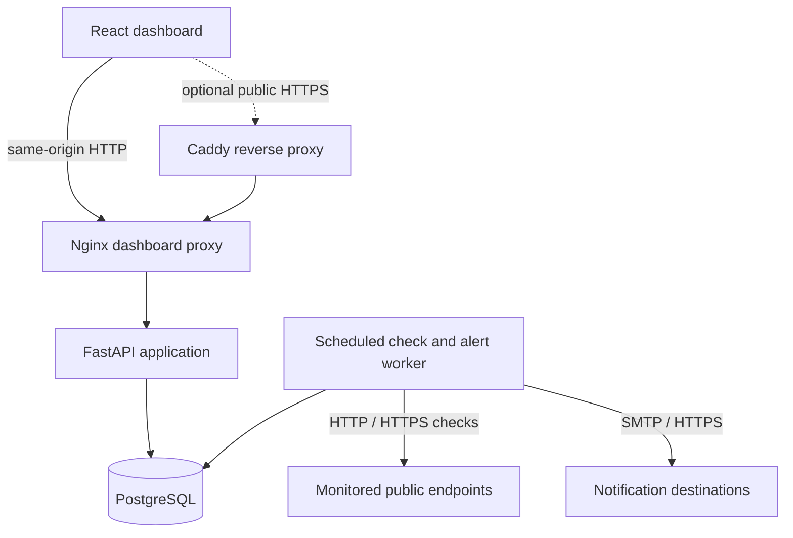

# Architecture

**PulseWatch · Arabome Obadiah Ayodeji**

## Component layout

Caddy is part of the optional production override, not the default local Compose topology.

## Check lifecycle

1. An administrator registers an endpoint and its check interval.
2. A worker claims due work using a time-bound lease.
3. The worker opens an outbound HTTP connection, validating the destination address at connection time.
4. The outcome is stored as a check result.
5. Consecutive failures update the incident state. A new incident can enqueue notifications.
6. A successful check resolves an open incident and can enqueue recovery notifications.
7. The dashboard reads the resulting state through the API.

## Design constraints

- Monitoring is **from the worker's network location**; it does not represent multi-region availability.
- HTTP checks currently support `GET` and `HEAD`; advanced synthetic transactions are out of scope.
- Response-time percentiles are calculated from the selected stored sample window; the dashboard's aggregation is not a global fleet percentile.
- Check and alert jobs should be treated as **at-least-once** operations. Durable outbox records limit duplicate event creation, not duplicate external deliveries.
- The application uses one shared workspace with administrator/viewer roles. It does not provide customer-level tenancy.
- Network-layer egress controls are required in addition to application DNS/IP validation.

## Key modules

| Module | Responsibility |
|---|---|
| `app/main.py` | REST endpoints and authorization dependencies |
| `app/worker.py` | Polling, claim/recovery and alert dispatch loop |
| `app/checks.py` | HTTP probes and incident state transitions |
| `app/alerts.py` | Alert rules, outbox and notification attempts |
| `app/safe_http.py` | Public-only transport for outbound HTTP |
| `app/models.py` | Persistent records |
| `app/auth.py` | Authentication and sessions |

## Design decision log

See [`DECISIONS.md`](DECISIONS.md) for tradeoffs that shaped the implementation.
